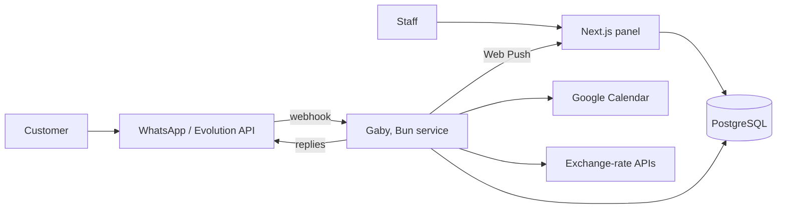

# Inversiones JS

> Two products for a store that sells phones on credit: a private panel where the staff keep the catalogue, customers and insurance plans up to date, and Gaby, the WhatsApp assistant that answers customers with that same data.

*Panel privado de Inversiones JS (catálogo, clientes con financiamiento y póliza RCV) y Gaby, su asistente de WhatsApp.*
*Lo que el equipo guarda en el panel es lo que Gaby responde al cliente en menos de un minuto.*

[Panel](https://inversiones-js.vercel.app) (login required) · In production · [](https://github.com/Fockus26/inversiones-js/actions/workflows/ci.yml)

<!-- Screenshots pending (demo data only, never real customers):
     docs/readme/panel-catalogo.png  (catalogue screen, 1440×900)
     docs/readme/panel-movil.png     (catalogue or requests on a phone, 390×844)
     docs/readme/gaby-chat.png       (a WhatsApp conversation with Gaby: menu, phone list, confirmation) -->

## What it does

**The panel (staff)**

- A staff member changes a phone's down payment, instalment, number of instalments or stock, and customers asking on WhatsApp get the new figures within a minute. Stock saves by itself as it is typed, from a phone.
- They hide a model or let it run out, and the assistant stops offering it. Brands can be added, renamed and removed.
- They keep the vehicle liability insurance (RCV) offer: plans per type of transport, the requirements list, and the exchange rates used to quote in euros, dollars, bolívares and Colombian pesos, taken automatically from public rate sources or typed by hand.
- They track each financed customer: the instalment plan, which instalments are paid, and for insurance customers the issue and expiry dates, with a one-step renewal.
- They see every request that came in through the chat (phones, insurance, appointments) in one place, and get a notification on their phone when a new one arrives. The panel installs as an app.

**Gaby (customers, on WhatsApp)**

- A customer writes to the store's WhatsApp and gets a three-option menu; a first message such as "I want a phone on credit" goes straight to that option.
- They see the numbered list of phones in stock with down payment and instalments, pick one, and receive the documents they need to apply.
- They get an insurance quote: type of transport, vehicle class, price in up to four currencies and the requirements, then leave name, email and phone. For foreign plates, they describe the vehicle and an advisor quotes it.
- They book an appointment from the free slots in the store's calendar and receive a reminder about a day before and another about two hours before.
- Insurance customers are reminded when their policy is 30 days and 3 days from expiring.
- The owner can take over at any time: writing by hand in a chat silences Gaby there, and `gaby off` silences it everywhere.

## How it is built

| Layer | Choice |
|---|---|
| Panel | Next.js 16 (App Router, Server Actions), React 19, strict TypeScript |
| UI | shadcn/ui on Base UI, Tailwind 4; installable PWA with a service worker for push and an offline page |
| Data | PostgreSQL with Drizzle ORM; SQL migrations; limits enforced as CHECK constraints |
| Auth | Better Auth, email and password, no public sign-up; access requires a row in an admins table, checked in every Server Action |
| Email | SMTP (password reset only) |
| Bot | Bun/TypeScript service in Docker; receives WhatsApp messages from Evolution API by webhook; conversation state in SQLite |
| Appointments | Google Calendar through a service account; reminders are marked on the event itself |
| Notifications | Standard Web Push (VAPID) from the bot to the installed panel |
| External data | DolarAPI (official euro rate in bolívares), ExchangeRate-API with a jsDelivr fallback (dollars and pesos) |
| Hosting | Panel on Vercel; database and bot on a VPS |



The bot imports the panel's own schema and domain code (`lib/db`, `lib/catalogo`, `lib/horario`, `lib/rcv`), so both read the data the same way. The contract between the two is written down in [`docs/chatbot.md`](docs/chatbot.md).

## Decisions worth noting

**One database for the panel and the bot, with the limits in the database.**
What the staff save has to be what the assistant answers, so both use the same Postgres database and the same Drizzle schema instead of syncing two stores. The bot reads through a 60-second in-memory cache: the catalogue is small and changes a few times a day, so a change shows up in under a minute without a query per message. Length, range and enum limits are CHECK constraints, so they also apply to what the bot writes, which never passes through the panel's validation. The cost: both share one database role (what the bot may write is limited in its code and by the constraints, not by permissions), and a new panel and a new bot have to be deployed together when the model changes.

**Moving off Firebase to Postgres with a way back.**
Data and auth moved from Firestore and Firebase Auth to Postgres and Better Auth. One table per former collection with the same field names kept the change inside the data-access layer for both the panel and the bot; document ids and user ids were preserved. Existing passwords kept working: the old Firebase scrypt hashes are still verified and are replaced by the new hash when a password changes. Documents were copied and compared by content on both ends, and the old database was left read-only for a month as a rollback. The cost: instalment plans stayed as JSON inside the customer row rather than a normalized table (no query filters by instalment today), and the Firebase tooling stays in the repo until the rollback window closes.

**Gaby does not message the staff on WhatsApp.**
The first version sent each new request to the advisors' phones. Outgoing messages from the business number to the same few phones raise the risk of WhatsApp banning it, so every flow now saves a request row and sends a Web Push notification to the installed panel. Standard Web Push with VAPID was chosen over Firebase Cloud Messaging: fewer pieces and the same coverage, including an installed iPhone app. The cost: if saving fails the request is only in the bot's log, and nobody finds out about a new request until they open the panel unless notifications are switched on in a phone.

**A human can take the chat back without touching a server.**
The owner answers customers from the same phone. A message sent from that phone that the bot did not send itself (it keeps a short record of its own messages by id and text) pauses Gaby in that chat for some hours; `gaby on`, `gaby off` and `gaby estado` work from the business phone's own chat or from an advisor's number. Replies are capped per chat and per hour, so a loop with another bot cannot flood the number. While off, Gaby does not mark messages as read, so they stay visible as unread; reminders already scheduled still go out. The cost: a customer who writes in a paused chat gets no automatic answer until the pause lapses or someone switches Gaby back on.

## Quality

- **Tests:** about 150 unit tests in 17 files for the panel (validation, instalment plans, policy dates, appointment slots, quotes, auth, the Firebase hash check, the Firestore-to-Postgres mapping) and about 38 in 5 files for the bot (conversation flow, manual control and send caps, database access, notices).
- **Database tests without Docker:** they run the real migrations on PGlite in memory, for the panel's data layer and for the bot's.
- **Testable conversation:** Gaby's conversation tree is a pure function that receives its services (catalogue, calendar, requests, clock, randomness), so tests walk it with fake data.
- **Reminders that do not duplicate:** a reminder is marked as sent before it is sent, in a single conditional update; losing one is preferred to sending it twice.
- **CI:** every pull request runs typecheck, lint (Biome), unit tests and a production build for the panel, and typecheck and tests for the bot in a separate job.

## Run it locally

Requires [Bun](https://bun.sh). The self-contained way to run the panel uses Docker for a throwaway PostgreSQL and a local mail catcher, loaded with seed data:

```bash
bun install
cp .env.example .env.test.local      # fill in the four *_TEST values with invented accounts
bun run qa:local -- --port 4301      # migrates, seeds and starts the panel on that port
```

Against a database of your own, set `DATABASE_URL` and `DIRECT_URL` in `.env.development.local`, then:

```bash
bun run db:migrate
bun run dev                          # http://localhost:3000
```

There is no public sign-up: accounts are created with `bun run admin:crear <email> --base=<database>`, which prints a temporary password once.

Environment variables, by name (see `.env.example` and `bot/.env.example`):

- Panel: `DATABASE_URL`, `DIRECT_URL`, `BETTER_AUTH_SECRET`, `BETTER_AUTH_URL`, `SMTP_HOST`, `SMTP_PORT`, `SMTP_USER`, `SMTP_PASSWORD`, `EMAIL_FROM`, `FIREBASE_HASH_*` (imported users), `NEXT_PUBLIC_VAPID_PUBLIC_KEY`
- Bot: `EVOLUTION_URL`, `EVOLUTION_API_KEY`, `EVOLUTION_INSTANCIA`, `WEBHOOK_TOKEN`, `DATABASE_URL`, `GOOGLE_CALENDAR_ID`, `ASESOR_NUMEROS`, `HORAS_PAUSA`, `MAX_POR_CHAT_10MIN`, `MAX_POR_HORA`, `VAPID_PUBLIC_KEY`, `VAPID_PRIVATE_KEY`, `VAPID_SUBJECT`

| Command | What it does |
|---|---|
| `bun run dev` | Development server |
| `bun run typecheck` | Types (includes `next typegen`) |
| `bun run lint` / `bun run format` | Biome |
| `bun run test` | Panel unit tests |
| `bun run build` | Production build |
| `bun run db:generate` | New migration in `drizzle/` after changing `lib/db/schema.ts` |
| `cd bot && bun install && bun run test` | Bot tests (install at the root first: the bot imports `lib/`) |

The bot itself needs a running Evolution API instance with a linked WhatsApp number and a Google Calendar shared with a service account; the steps are in [`bot/DESPLIEGUE.md`](bot/DESPLIEGUE.md).

## Project structure

```
app/            Panel routes: catalogue, insurance, customers, chat requests, login, password reset
  api/          Auth handler and the two exchange-rate proxies
components/     Panel screens and UI primitives (shadcn/ui)
lib/            Domain code shared by the panel and the bot
  data/         Server Actions; each one checks the admin session first
  db/           Drizzle schema, client, seed
  catalogo/     Catalogue types, validation, price-list text
  rcv/          Insurance plans, quotes and rate sources
  financiamiento/  Instalment plans, policy dates, reminders due
  horario/      Opening hours and free appointment slots
bot/            Gaby: webhook server, conversation flow, texts, reminders, push notices
drizzle/        SQL migrations
tests/unit/     Panel tests (bot tests live in bot/tests/)
scripts/        Admin creation, local QA stack, migration tooling
docs/           The panel-bot data contract and the design handoff
context/        Numbered decision records
```

## My role

Built for Inversiones JS. I developed both products: the panel, the data model and its migration from Firebase to Postgres, the WhatsApp assistant with its conversation flow, calendar booking and reminders, and the deployment of both.
